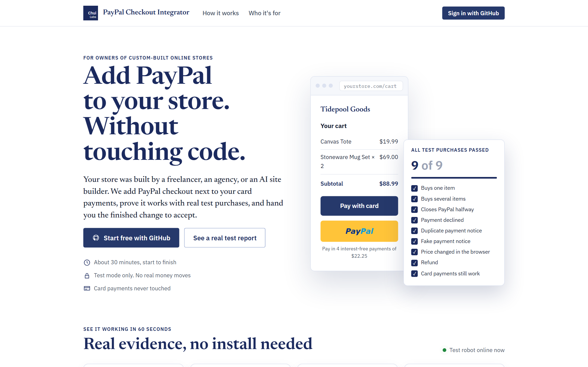
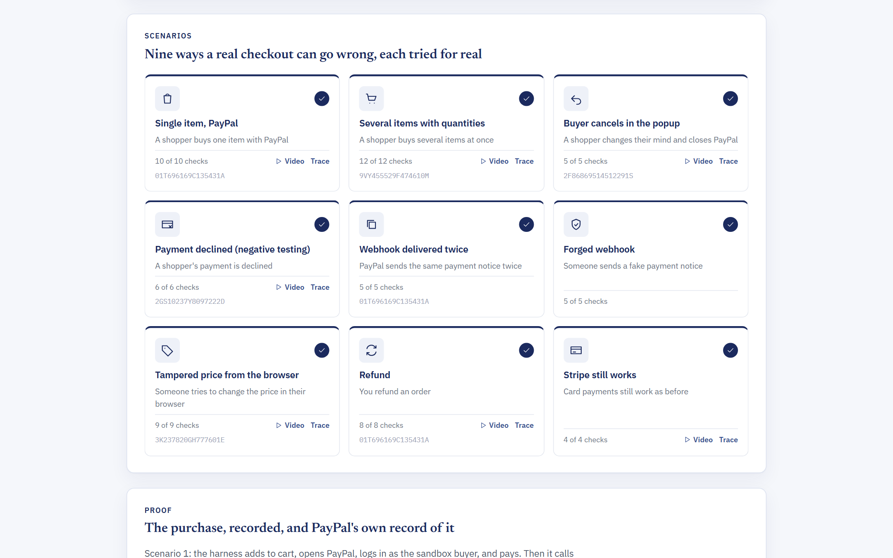
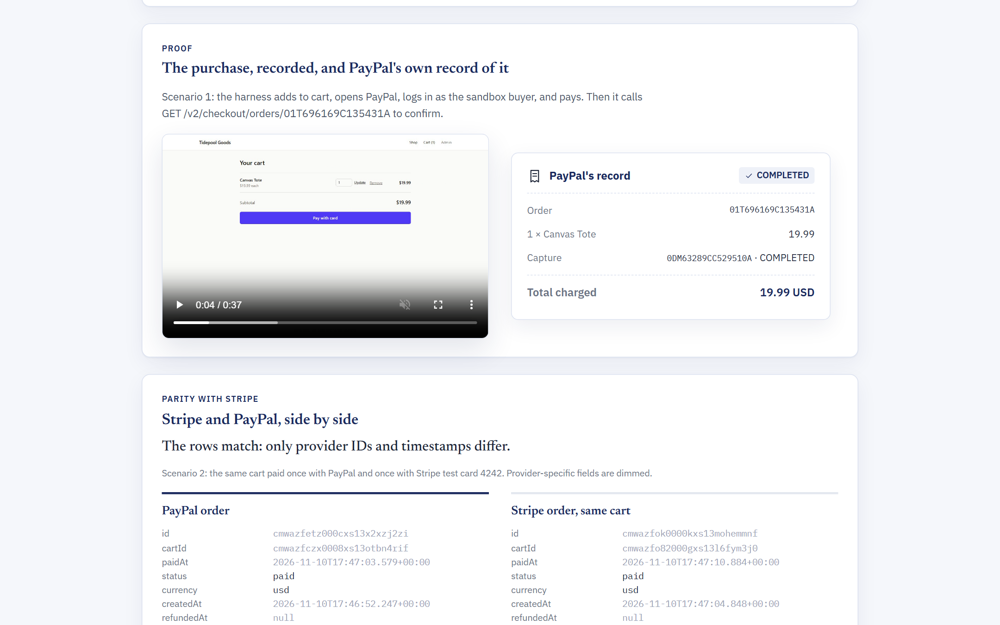
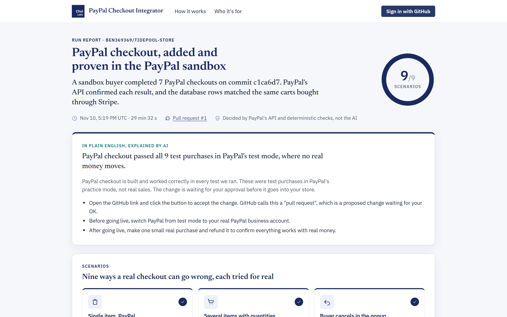
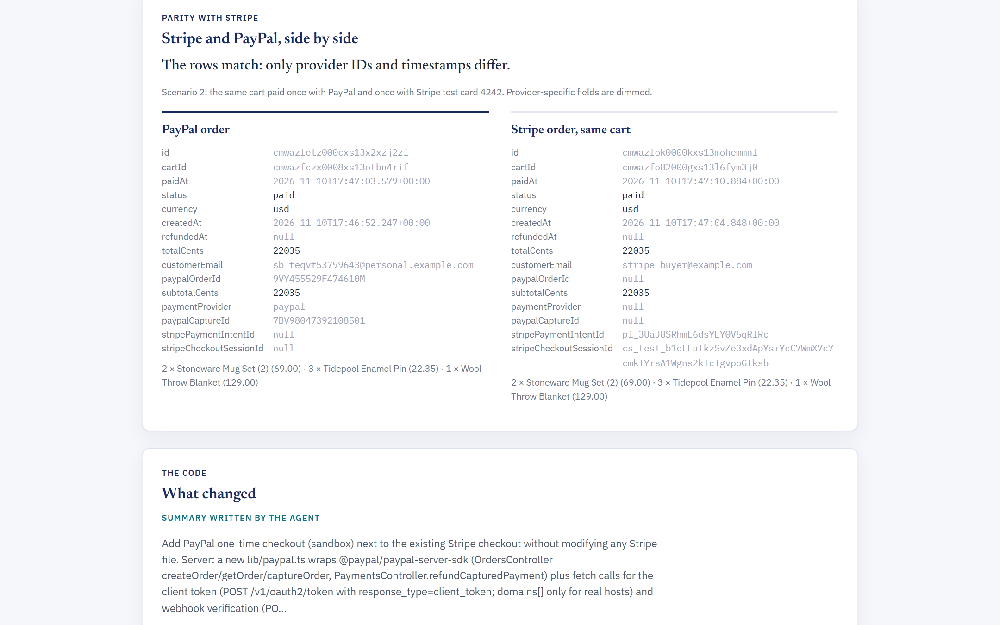

# PayPal Checkout Integrator

**by Chui Labs**

**Add PayPal checkout to a custom-built online store without touching code, and prove it works with real PayPal test purchases before anything changes.**

Store owners whose shop was built by a freelancer, an agency, or an AI site builder sign in with GitHub and click one button. An AI agent reads the store, explains its plan in plain English, adds PayPal next to the existing card payments, and then a robot shopper makes nine real PayPal sandbox purchases. The owner gets the finished change as a pull request with a green check. After that, every later change to the store is re-tested the same way.

**The AI writes the code. PayPal's own API and deterministic checks decide whether it works.**

## See it working in 60 seconds (no install needed)

| | |
|---|---|
| **Live app** | https://paypal-checkout-integrator.onrender.com |
| **A real test report** (9 of 9) | [Run report](https://paypal-checkout-integrator.onrender.com/runs/85837239-b6c8-415d-a4a2-65cc8c1c00fb/report): scenario results, purchase video, PayPal's record of the order, Stripe and PayPal database rows side by side |
| **The change it handed over** | [tidepool-store PR #1](https://github.com/Ben369369/tidepool-store/pull/1): one commit per stage, the green "PayPal checkout" check, setup steps, "what I couldn't verify" |
| **A bug it caught** | [tidepool-store PR #3](https://github.com/Ben369369/tidepool-store/pull/3): a later change trusted the browser's total. The check went red (7 of 9), and the comment explains that a shopper could pay $0.01 for a $129 order |
| **Demo video** | _link added on submission_ |

The test robot (worker) runs on the maker's machine. If it's off when you visit, the site says so, new requests wait in line, and all finished reports still work.



| | |
|---|---|
|  |  |
|  |  |

## Who it's for

- **Store owners with no coding experience.** The default **Simple view** uses plain English throughout: what customers will see, what changes, what stays the same, and the one thing to do next. The AI's explanations are written from the plan and test results, and clearly labeled as AI-written.
- **Agencies and freelancers.** Add PayPal to a client's store and hand them the test report as proof.
- **Developers.** A **Developer view** toggle shows the repo map, every planned file, attempts, scenario evidence, Playwright traces, and a live log.

## How it works

1. **Sign in with GitHub and connect a store.** The owner installs the GitHub App on the store's repository. Each owner sees only their own stores.
2. **Optional: connect a PayPal test account.** A guided 2-minute walkthrough of developer.paypal.com. Without it, runs use the demo sandbox account.
3. **Click "Add PayPal checkout".** A Claude agent (`claude-opus-5-5`) reads the store and writes a **repo map** (checkout, cart, order model, every Stripe file) and a **file plan**.
4. **Approve the plan.** The owner sees it in plain English. Nothing is written until they click "Looks good, build it".
5. **The agent writes the integration.**
   - Server: the APIMatic-generated `@paypal/paypal-server-sdk` (Orders v2 create and capture, refunds) with `PayPal-Request-Id` idempotency.
   - Browser: PayPal JS SDK v6 `<paypal-button>` with a browser-safe client token, and Pay Later messaging.
   - Verified, idempotent webhooks (`PAYMENT.CAPTURE.COMPLETED / DENIED / REFUNDED`) and a Prisma migration.
   - Before using any SDK name, the agent looks it up with the **APIMatic Context Plugin** and checks the installed type definitions.
6. **Deterministic gates.** Install, type check, lint, and build, then four guards:
   - every SDK method called exists in the installed types (checked by the TypeScript compiler);
   - only planned files changed;
   - Stripe files are untouched;
   - no secrets are in the diff.
7. **Proof with real purchases.** The harness builds the branch, starts the store, and buys with a real PayPal sandbox buyer in Playwright. It confirms each result with `GET /v2/checkout/orders/{id}`, snapshots the store's database, and buys the same cart through Stripe (test card 4242) to compare the rows.
8. **Repair.** If anything fails, the agent gets the exact evidence (failed checks, API responses, server log) and edits only the files involved, for up to 4 rounds. Otherwise it opens a draft PR that lists the failures.
9. **Pull request.** One commit per stage, a scenario table, a link to the run report, setup steps, and a "what I couldn't verify" list, plus a **"PayPal checkout"** check run.
10. **Every later PR is re-tested.** Later PRs run only the harness, with no code generation. On failure the app posts a review comment with the likely cause in plain English, labeled as AI-written. Docs-only and CI-only PRs are skipped.

## The nine scenarios

| # | Scenario | Passes when |
|---|---|---|
| 1 | Single item | PayPal API says COMPLETED; order paid; DB rows match the same Stripe purchase |
| 2 | Several items with quantities | Capture equals the cart total to the cent; PayPal, Stripe, and DB line items match |
| 3 | Buyer cancels in the popup | No paid order; cart intact |
| 4 | Payment declined | Sandbox negative testing (`PayPal-Mock-Response: INSTRUMENT_DECLINED`); buyer sees an error; no paid order |
| 5 | Webhook delivered twice | A real signed `PAYMENT.CAPTURE.COMPLETED` is accepted once and acknowledged as a duplicate |
| 6 | Forged webhook | Unsigned events and a real signature on an altered body are rejected |
| 7 | Tampered price from the browser | The create-order request is rewritten to $0.01; PayPal still charges the real total |
| 8 | Refund | Admin refund marks the order refunded; PayPal shows the capture REFUNDED; the refund webhook is accepted; same end state as a Stripe refund |
| 9 | Stripe still works | The original Stripe Checkout flow passes unchanged |

**Results so far:**
- **Hosted end-to-end run** on the Stripe-only demo store: 9 of 9, in about 30 minutes and $3.38 of model usage. The agent made 5 commits across about 20 files and 13 APIMatic Context Plugin lookups. It needed no code repairs; one harness re-run was caused by a Windows file-lock error during `pnpm install` on the test machine.
- **Regression caught:** a later PR that sent the total from the browser failed scenarios 2 and 7. PayPal captured $0.01 for a $129.00 cart, and the check went red before merge.
- A hand-written reference integration also passes all nine.

### Real webhooks for a store that isn't public

The store under test runs on a private machine, so PayPal can't reach it. The app runs a **pull-model webhook relay** instead:

1. For each run, the harness registers a temporary PayPal webhook that points at the hosted relay.
2. The relay stores each delivery byte for byte.
3. The harness replays it to the store with PayPal's original `paypal-*` headers.

PayPal verifies signatures from the headers, body, and webhook id, not from the delivery URL, so replayed events verify like direct deliveries. Replays are also how scenario 5 delivers an event twice and scenario 6 alters one. (The simulator's events can't be used, because they fail signature verification.)

## Where AI is used, and where it isn't

| AI does | AI never does |
|---|---|
| Reads the store and writes the repo map and plan | Decide whether a run passed |
| Writes the integration and repairs failures from evidence | Touch Stripe files (blocked by a guard and the file-write tool) |
| Explains the plan and results in plain English for owners | See credentials (commands it runs get a scrubbed environment) |
| Suggests the likely cause when a later PR breaks checkout | Merge anything (the owner accepts the PR) |

## Architecture

```
apps/web          Next.js on Render: landing page, Sign in with GitHub, store dashboard
                  (Simple and Developer views), plan review, live runs, public run reports,
                  GitHub webhooks, PayPal webhook relay, GitHub App manifest setup
apps/worker       Job runner (pg-boss): clones as the app, runs the agent and harness,
                  pushes the branch, opens the PR, posts check runs and review comments,
                  writes plain-English explanations, checks in every minute
packages/agent    Claude agent: analyze → plan → implement → guards → repair loop
packages/harness  Real-sandbox scenario runner, Stripe parity diff, webhook relay
packages/shared   Postgres schema, encrypted settings, queue, GitHub App client
fixtures/store-a  The demo store (published as tidepool-store)
docs/             Chui Labs design spec, demo script
```

- **Hosting:** the web app and Postgres run on Render's free tier. The worker needs a browser and about 2 GB of RAM, so it runs on the maker's machine and pulls jobs from the hosted database. Moving it to a Render instance needs no code changes.
- **Security:**
  - Sign in with GitHub uses the GitHub App's user authorization. Each session only sees installations that GitHub says the user can access.
  - The GitHub App's private key, user tokens, and per-store sandbox credentials are encrypted at rest (AES-256-GCM).
  - Installation tokens are redacted from logs and error messages.
  - The agent's file writes are restricted to the approved plan, and Stripe files are always blocked.

## Run it

**Requirements:** Node 22+, pnpm, a PayPal sandbox app with a sandbox Personal (buyer) account, a Stripe test key, an Anthropic API key, and [`cloudflared`](https://developers.cloudflare.com/cloudflare-one/connections/connect-networks/downloads/) for local webhook delivery.

```bash
pnpm install
cp .env.example .env.local        # fill in the sandbox and test credentials
pnpm --filter @paypal-checkout-integrator/harness exec playwright install chromium

# prove a branch with the harness
pnpm --filter @paypal-checkout-integrator/harness run -- --ref <branch> --app fixtures/store-a

# have the agent add PayPal to the Stripe-only store and prove it
pnpm --filter @paypal-checkout-integrator/agent run -- --base main --app fixtures/store-a --yes
```

**Hosted setup:**
1. Deploy `render.yaml` as a Render Blueprint.
2. Open `/setup` and click **Create the GitHub App**. The app is created from a manifest with exactly the permissions it needs. Add `https://<your-host>/api/auth/callback` as its callback URL for Sign in with GitHub.
3. Install the app on a repository.
4. Run the worker: put `DATABASE_URL` (external), `ENCRYPTION_KEY`, and `PUBLIC_URL` from Render in `.env.local`, then run `pnpm --filter @paypal-checkout-integrator/worker start`.

Evidence for every run is saved: videos, Playwright traces, PayPal API responses, DB snapshots, and agent transcripts. It goes to `runs/` and `agent-runs/` locally. Hosted runs upload it to the run report.

## Built with

- **Claude `claude-opus-5-5`** via the Anthropic TypeScript SDK:
  - a streaming tool-use loop with adaptive thinking, prompt caching, and server-side fallback;
  - structured outputs (Zod) for the plan and for the plain-English explanations.
- **APIMatic:**
  - the **Context Plugin** for the PayPal Server SDK (TypeScript), which the agent calls over MCP before using any SDK name;
  - the APIMatic-generated **`@paypal/paypal-server-sdk`**, used by every generated integration.
- **PayPal:** JS SDK v6, Orders v2, Payments (refunds), webhooks with signature verification, and sandbox negative testing.
- Next.js 16, Prisma 7, Stripe Checkout, Playwright, Postgres and pg-boss, Octokit, Render, and Cloudflare quick tunnels.

## Honest limits

- **Scope:**
  - Only Next.js App Router stores that use Stripe Checkout Sessions and Prisma.
  - Only one-time PayPal checkout: no subscriptions, vaulting, or multi-currency.
  - Proven on one store so far. A second store with a different structure is planned.
- **Pay Later messaging isn't verified.** PayPal only renders it on HTTPS pages, so on the harness's localhost store we only check that the element is present.
- **Speed and cost:** a full add-PayPal run takes about 30 minutes (most of it the agent writing code, then about 8 minutes of real sandbox purchases) and costs about $3.50 in model usage. A later-PR check takes about 7 minutes.
- **Scenario 4 needs a test hook.** It relies on the generated capture route forwarding `PayPal-Mock-Response`, and only when `PAYPAL_ENV=sandbox`.
- **The worker runs on the maker's machine**, so new runs only start while it's on. The site shows a notice when it's offline, and queued requests start when it returns. The free Render web service sleeps when idle, so the worker pings it to keep GitHub and PayPal webhooks flowing.
- **Sandbox only.** Going live means switching to the owner's live PayPal credentials, which this project deliberately never handles.

## How this differs from Cutover

[Cutover](https://devpost.com/software/cutover) is another PayPal + AI project on Devpost. Its page describes an AI agent that **migrates legacy PayPal integrations** to newer PayPal APIs, and proves in the sandbox that checkout behaves the same ("7 of 7 scenarios identical", verified by PayPal), with live old and migrated demo shops. It's a strong idea, and we share its core belief: let PayPal's sandbox API, not the model, decide whether checkout works.

PayPal Checkout Integrator differs in five ways:

| | Cutover (per its Devpost page) | PayPal Checkout Integrator |
|---|---|---|
| Starting point | A store that already uses PayPal (legacy APIs) | A store that has **never** used PayPal (Stripe only) |
| Who it's for | Developers maintaining a PayPal integration | **Store owners with no coding experience**, with a Developer view for technical users |
| Reference for "correct" | The store's old PayPal behavior | The store's **Stripe** behavior: a DB-row diff of the same cart paid both ways |
| Delivery | Migrated shop | A **GitHub App**: plain-English plan approval, a PR with one commit per stage, a check run, and a run report |
| After the first change | n/a | A **"PayPal checkout" check on every later PR**, so regressions are caught before merge |

## License

MIT © 2026 Chui Labs
